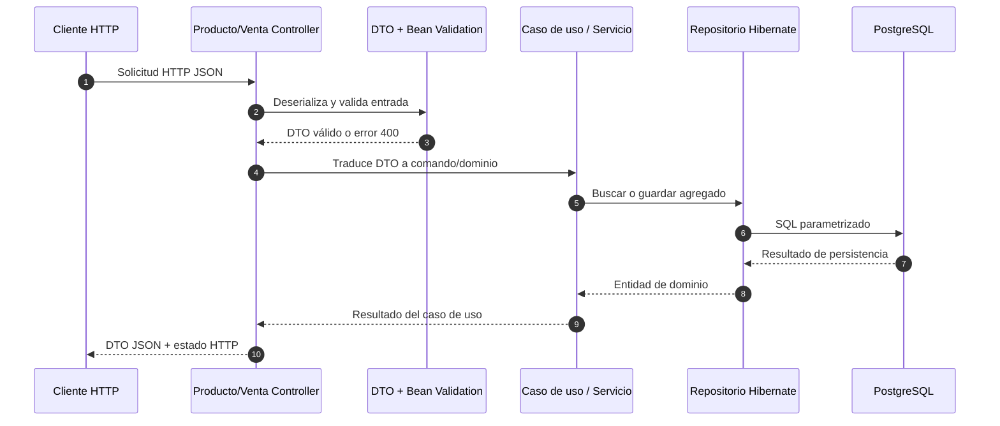

# P09 / M12 — Reporte integrador de API REST

## 1. Propósito y alcance

Este documento describe el incremento de la API REST de ventas implementado
con Spring Boot, Java 11 y persistencia Hibernate sobre PostgreSQL. El
contrato expone productos y permite confirmar ventas sin exponer entidades de
persistencia, credenciales ni trazas internas.

La API se ejecuta en `http://localhost:8080`. (API REST)
Interfaz Swagger en `http://localhost:8080/swagger-ui/index.html`.

## 2. Matriz de recursos, métodos y estados

| URI | Método | Cuerpo de entrada | Respuesta exitosa | Errores documentados |
|---|---|---|---|---|
| `/api/v1/productos` | `GET` | Ninguno | `200 OK`, arreglo de productos | `500 Internal Server Error` |
| `/api/v1/productos` | `POST` | `id`, `nombre`, `precio`, `existencia` | `201 Created`, producto creado | `400 Bad Request`, `500 Internal Server Error` |
| `/api/v1/productos/{id}` | `GET` | Parámetro `id` positivo | `200 OK`, producto | `404 Not Found`, `500 Internal Server Error` |
| `/api/v1/ventas` | `POST` | Arreglo `detalles` con `productoId` y `cantidad` | `201 Created`, venta confirmada | `400 Bad Request`, `409 Conflict`, `500 Internal Server Error` |

### Representaciones JSON

Producto:

```json
{
  "id": 101,
  "nombre": "Teclado Mecánico",
  "precio": 450.50,
  "existencia": 15
}
```

Alta de producto:

```json
{
  "id": 101,
  "nombre": "Teclado Mecánico",
  "precio": 450.50,
  "existencia": 15
}
```

Confirmación de venta:

```json
{
  "detalles": [
    {
      "productoId": 101,
      "cantidad": 2
    }
  ]
}
```

## 3. Ejemplos de respuestas

### `200 OK` — Consulta de productos

```http
HTTP/1.1 200 OK
Content-Type: application/json
```

```json
[
  {
    "id": 101,
    "nombre": "Teclado Mecánico",
    "precio": 450.50,
    "existencia": 15
  }
]
```

### `201 Created` — Producto creado

```http
HTTP/1.1 201 Created
Content-Type: application/json
```

```json
{
  "id": 101,
  "nombre": "Teclado Mecánico",
  "precio": 450.50,
  "existencia": 15
}
```

### `400 Bad Request` — Entrada inválida

La respuesta usa la estructura de Problem Details de RFC 9457. El campo
`timestamp` es generado por la aplicación y, por ello, varía en cada
solicitud.

```http
HTTP/1.1 400 Bad Request
Content-Type: application/json
```

```json
{
  "type": "https://tcsw-ventas.invalid/errors/validation-error",
  "title": "Error de Validación de Formato",
  "status": 400,
  "detail": "nombre: El nombre no puede estar vacío",
  "instance": "/api/v1/productos",
  "timestamp": "2026-11-08T18:00:00"
}
```

### `404 Not Found` — Producto inexistente

La consulta de un producto que no existe devuelve `404` sin incluir detalles
internos de persistencia.

### `409 Conflict` — Existencia insuficiente

Cuando la cantidad solicitada supera la existencia disponible, el dominio
genera un conflicto de regla de negocio y la API responde `409`.

### `500 Internal Server Error` — Fallo de persistencia

```http
HTTP/1.1 500 Internal Server Error
Content-Type: application/json
```

```json
{
  "type": "https://tcsw-ventas.invalid/errors/persistence-failure",
  "title": "Fallo de Persistencia",
  "status": 500,
  "detail": "Error en la capa de datos. Verifique la consistencia del registro.",
  "instance": "/api/v1/ventas",
  "timestamp": "2026-11-08T18:00:00"
}
```

No se devuelven excepciones, SQL, credenciales ni trazas al consumidor.

## 4. Diagrama de interacción



## 5. Separación arquitectónica

- El paquete `domain` contiene las reglas de producto, venta, stock y
  descuentos, sin dependencias de Spring.
- Los controladores REST traducen HTTP y DTOs a puertos de aplicación.
- Hibernate y PostgreSQL se encuentran en adaptadores de salida.
- `ApiExceptionHandler` transforma errores a respuestas sanitizadas.

## 6. Verificación reproducible

1. Definir `POSTGRES_PASSWORD`, `DB_PASSWORD` y, opcionalmente, `DB_URL`.
2. Iniciar PostgreSQL con `docker compose up -d`.
3. Iniciar la API con `mvn spring-boot:run` o ejecutar el artefacto
   equivalente.
4. Abrir [pruebas_http.http](./pruebas_http.http) desde un IDE compatible con
   archivos HTTP.
5. Ejecutar las solicitudes en orden y conservar las respuestas como evidencia
   de P09.

Las solicitudes positivas y negativas del archivo HTTP cubren los recorridos
principales del contrato.

## 7. Evidencia de ejecución contra la API activa

La API fue probada el **8 de noviembre de 2026** contra
`http://localhost:8080`. Se utilizó el producto de prueba `91839`, creado
durante la ejecución con una existencia inicial de `15`.

| Prueba | Resultado esperado | Resultado observado | Estado |
|---|---:|---:|---|
| `GET /api/v1/productos` | `200` | `200` | VERIFICADO |
| `POST /api/v1/productos` válido | `201` | `201` | VERIFICADO |
| `POST /api/v1/productos` inválido | `400` | `400` | VERIFICADO |
| `GET /api/v1/productos/91839` | `200` | `200` | VERIFICADO |
| `GET /api/v1/productos/999997` | `404` | `404` | VERIFICADO |
| `POST /api/v1/ventas` válido | `201` | `201` | VERIFICADO |
| Venta con stock insuficiente | `409` | `409` | VERIFICADO |
| Venta sin detalles | `400` | `400` | VERIFICADO |
| Venta con producto inexistente | `500` | `500` | VERIFICADO |

La venta válida respondió con una cantidad de `2`, subtotal `901.00` y
existencia resultante `13`. Los escenarios `400`, `409` y `500` devolvieron
respuestas estructuradas con `type`, `title`, `status`, `detail`, `instance`
y `timestamp`, sin trazas ni información de infraestructura.
