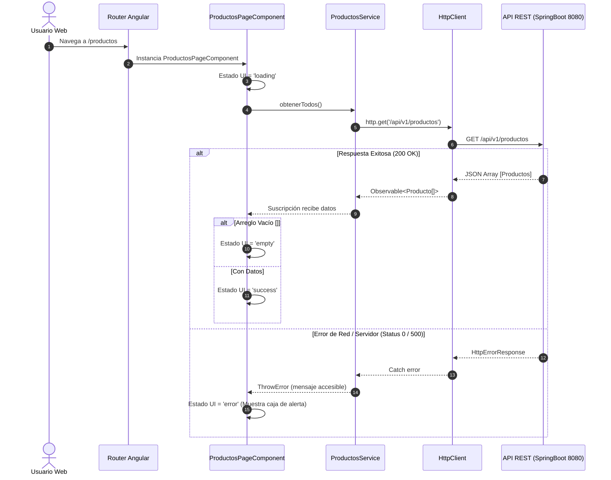

# 📄 Reporte de Integración Cliente Angular (P10 / M13)

**Experiencia Educativa:** Tecnologías para la Construcción de Software  
**Proyecto:** `tcsw-ventas` | **Módulo:** M13 — Angular Básico  

---

## 1. Árbol de Componentes y Separación de Responsabilidades

| Componente / Clase | Tipo | Responsabilidad Arquitectónica |
| :--- | :---: | :--- |
| **`ProductosPageComponent`** | Página (Coordinador) | Consume `ProductosService`, coordina la navegación y gestiona el ciclo de estados UI (`idle` -> `loading` -> `success` / `empty` / `error`). |
| **`ProductoListComponent`** | Presentación Pura | Recibe el arreglo `Producto[]` mediante `@Input()` y renderiza la tabla accesible, este no conoce endpoints HTTP. |
| **`ProductoFormComponent`** | Presentación / Formulario | Gestiona el formulario reactivo (`FormGroup`), aplica reglas de validación cliente y emite la petición de alta. |
| **`ProductosService`** | Servicio Inyectable | Centraliza la comunicación HTTP consumiendo la API `/api/v1/productos` mediante `HttpClient` y mapea errores. |

---

## 2. Matriz de Rutas de la Aplicación

| Ruta URL | Componente Asociado | Título Accesible | Regla de Ordenamiento |
| :--- | :--- | :--- | :--- |
| `/` | `RedirectTo: /productos` | N/A | Coincidencia exacta inicial |
| `/productos` | `ProductosPageComponent` | Catálogo de Productos - tcsw-ventas | Ruta de lista principal |
| `/productos/nuevo` | `ProductoFormComponent` | Registrar Producto - tcsw-ventas | Ruta específica (antes de parámetros) |
| `**` | `RedirectTo: /productos` | Error / Redirección | Comodín final |

---

## 3. Diagrama de Interacción Asíncrona

