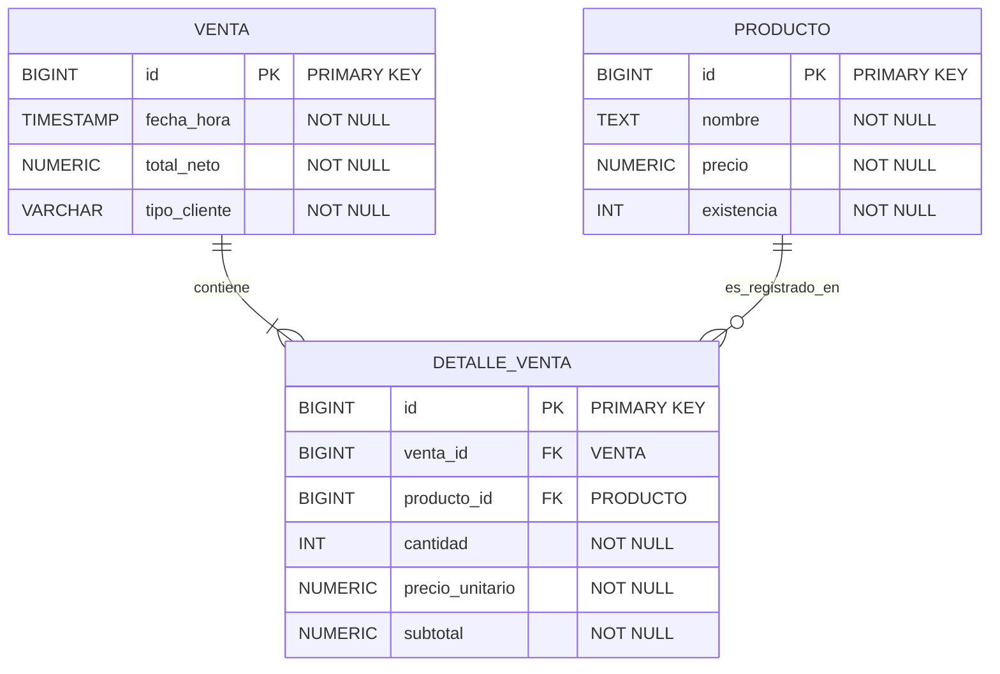

# Especificación Técnica: Modelo Relacional y Mapeo de Persistencia (P08 / S28-S30)

## 1. Mapeo Módulo a Módulo: Dominio Java vs. PostgreSQL 16

| Atributo `domain.Producto` | Columna PostgreSQL | Tipo SQL        | Reglas de Dominio e Integridad Declarativa                      |
| :------------------------- | :----------------- | :-------------- | :-------------------------------------------------------------- |
| `id` (`long`)              | `id`               | `BIGINT`        | `PRIMARY KEY`, `NOT NULL` (Identificador estable de la entidad) |
| `nombre` (`String`)        | `nombre`           | `TEXT`          | `NOT NULL`, `CHECK (length(trim(nombre)) > 0)`                  |
| `precio` (`BigDecimal`)    | `precio`           | `NUMERIC(12,2)` | `NOT NULL`, `CHECK (precio >= 0.00)`                            |
| `existencia` (`int`)       | `existencia`       | `INTEGER`       | `NOT NULL`, `CHECK (existencia >= 0)`                           |

## 2. Decisiones Arquitectónicas de Desacoplamiento (Hexagonal vs. ORM/JDBC)

- **Aislamiento de Entidades:** Las clases del paquete `domain` (`Producto`, `Venta`) no contienen anotaciones de JPA (`@Entity`, `@Table`) ni importaciones de `java.sql.*` ya que tomamos en cuenta preservar las invariantes puras sin depender de infraestructura.
- **Rol de Adaptadores y Mapeadores:** Los adaptadores de persistencia (`ProductoJdbcRepository` y `ProductoHibernateRepository`) traducen filas relacionales hacia objetos del dominio reconstruyendo el estado sin bypass de invariantes.

## 3. Ciclo de Vida de Entidades en Persistencia (S28)

1. **Transitoria (_Transient_):** Instancia `new Producto(...)` creada en memoria, aún no vinculada al contenedor ni con registro en la base de datos.
2. **Administrada / Persistida (_Managed_):** Estado en el que la entidad se encuentra vinculada al contexto de persistencia (vía `PreparedStatement` ejecutado o sesión activa de Hibernate).
3. **Separada (_Detached_):** Instancia cuyos datos existen en la BD pero cuya sesión/conexión se ha cerrado deterministamente.

## 4. Frontera de Transacciones y Contenedor reproducible (S29 / S30)

- **Atomicidad:** Toda operación de escritura debe completarse o revertirse (`ROLLBACK`) ante fallos de restricciones `CHECK`.
- **Persistencia en Docker:** Uso de volumen nombrado `pgdata` en PostgreSQL 16 para garantizar que los datos sobrevivan al reinicio del contenedor.

## 5. Modelo Relacional

---
