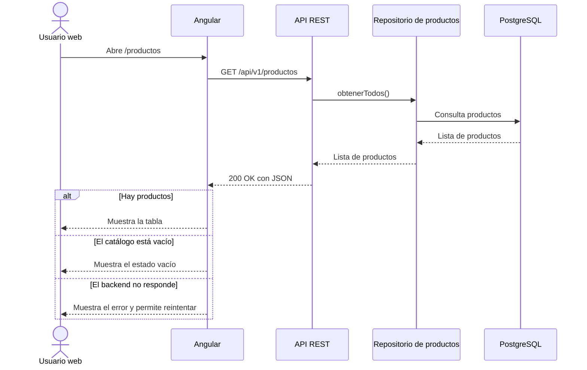
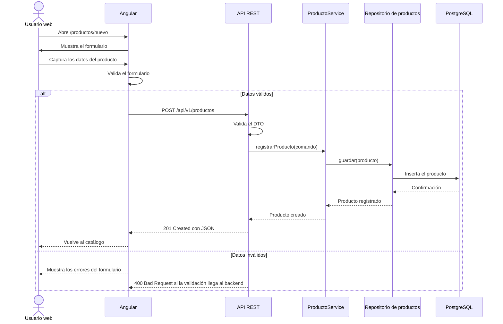
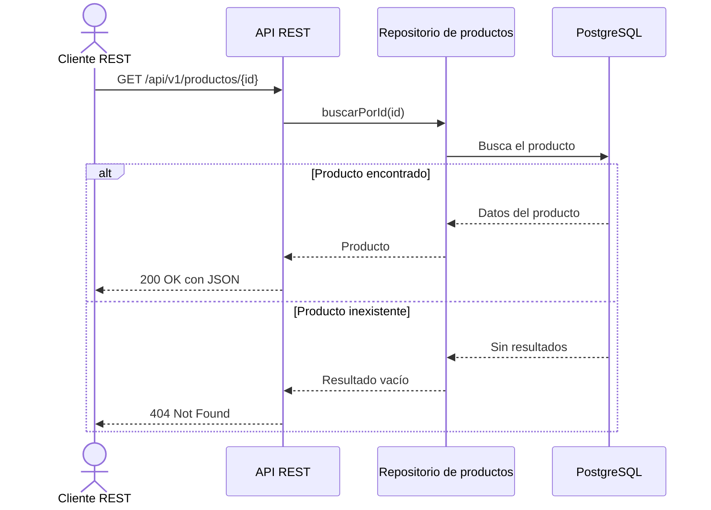
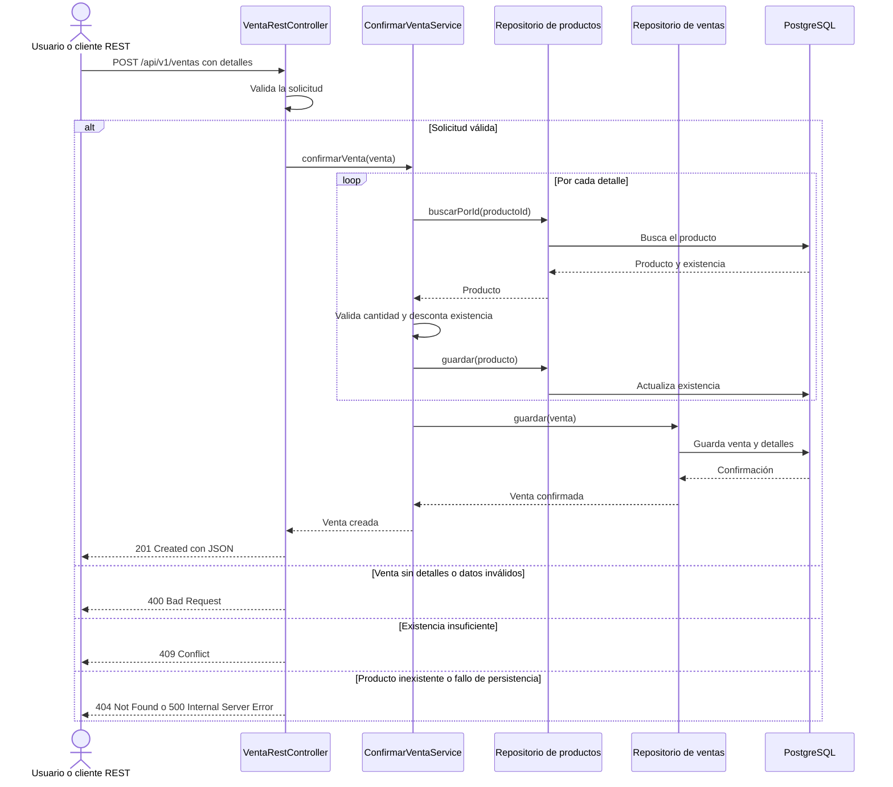
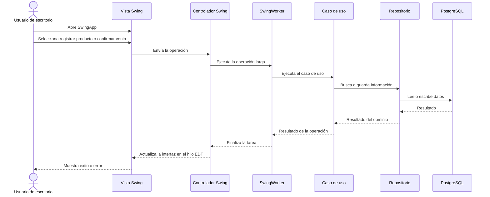
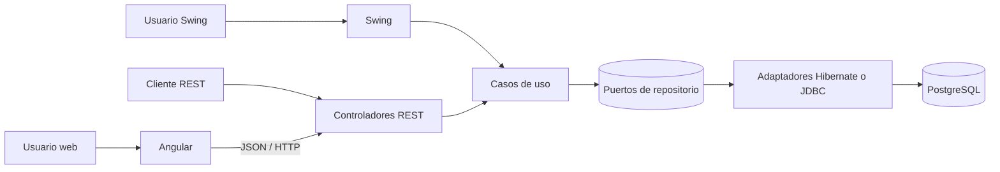
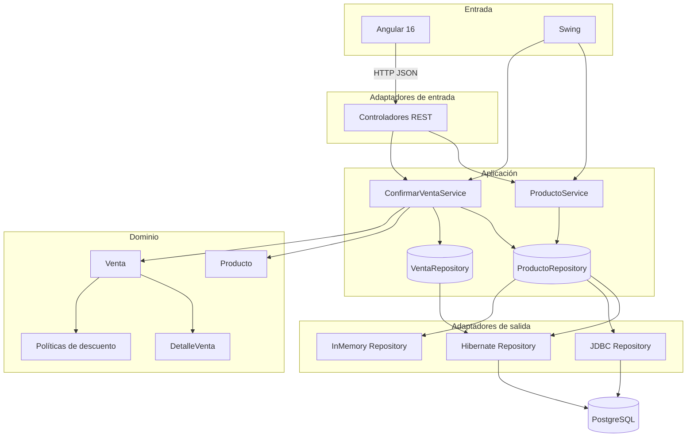
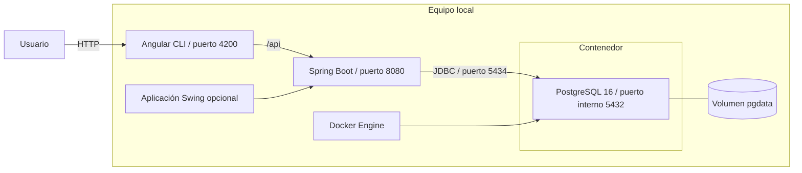
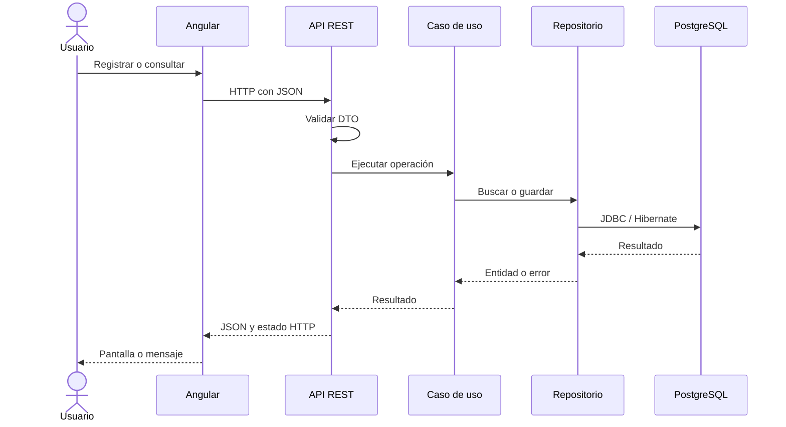
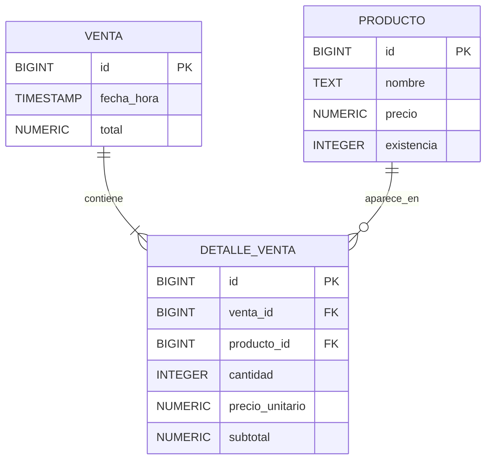

# Corte C03: Reporte integral de integración web

**Proyecto:** `tcsw-ventas`  
**Equipo:** TCSW-E05  
**Experiencia Educativa:** Tecnologías para la Construcción de Software, NRC 19234  
**Docente:** Dr. Gabriel Rodríguez Vásquez  
**Versión:** `v0.3-web`  
**Fecha del reporte:** 19 de noviembre de 2026

---


## 1. Resumen ejecutivo

`tcsw-ventas` es un sistema para registrar productos y confirmar ventas. El proyecto comenzó con una aplicación de escritorio y fue creciendo hasta incluir una API REST y una aplicación web.

En el corte C03, el sistema quedó organizado como una solución web integrada por tres partes:

- Angular muestra el catálogo y permite registrar productos.
- Spring Boot recibe las solicitudes y aplica las reglas del sistema.
- PostgreSQL guarda productos y ventas.

También se conservó el cliente Swing desarrollado en cortes anteriores. La aplicación utiliza arquitectura hexagonal, por lo que el dominio no depende directamente de interfaces gráficas ni de tecnologías de base de datos.

Los resultados principales de este corte fueron:

- API REST disponible en el puerto `8080`.
- Cliente Angular disponible en el puerto `4200`.
- PostgreSQL disponible desde el equipo anfitrión en el puerto `5434`.
- Documentación OpenAPI y Swagger.
- Respuestas de error claras y sin información técnica sensible.
- Manejo de errores cuando el servidor REST o el proxy no están disponibles.
- Pruebas backend de 79 casos, todas aprobadas.
- Cobertura reportada por SonarQube: **84.8 %**.

La guía principal de instalación se encuentra en [../../README.md](../../README.md). Los detalles históricos de API, Angular y arquitectura se encuentran en [la sección de trazabilidad documental](#17-trazabilidad-documental).

---

## 2. Datos del proyecto

| Campo | Información |
|---|---|
| Nombre del proyecto | `tcsw-ventas` |
| Propósito | Gestión de productos y confirmación de ventas |
| Corte | C03 — Integración Web |
| Versión de entrega | `v0.3-web` |
| Equipo | TCSW-E05 |
| Integrante 1 | Victor Gustavo Reyes Vidal — `Novaxll` |
| Integrante 2 | Ana María Reyes Hernández — `Yan25102309` |
| Materia | Tecnologías para la Construcción de Software |
| NRC | 19234 |
| Backend | Java 11 y Spring Boot 2.7.18 |
| Frontend | Angular 16 |
| Base de datos | PostgreSQL 16 |
| Pruebas Java | JUnit 5, ArchUnit y MockMvc |
| Pruebas Angular | Jasmine y Karma con ChromeHeadless |
| Cobertura usada como referencia | 84.8 % en SonarQube |

---

## 3. Alcance y objetivos

### 3.1. Objetivo general

Crear un sistema de ventas que separa las reglas de negocio de la interfaz y de la base de datos, permitiendo usar la misma lógica desde una aplicación web, una API REST y una aplicación Swing.

### 3.2. Funciones incluidas

- Registrar productos.
- Consultar todos los productos.
- Controlar la existencia disponible.
- Confirmar una venta.
- Descontar existencias al confirmar una venta.
- Calcular el total de una venta.
- Mostrar la respuesta de errores de forma clara.
- Continuar ofreciendo el cliente Swing para operaciones de escritorio.

### 3.3. Funciones fuera del alcance actual

Este corte no incluye algunas cosas tales como:

- Inicio de sesión o autenticación de usuarios.
- Roles y permisos.
- Administración de clientes.
- Facturación electrónica.
- Pagos electrónicos.
- Devoluciones o cancelaciones.
- Paginación del catálogo.
- Despliegue completo de los tres componentes con un único contenedor.
- Un pipeline de integración continua configurado en el repositorio.

Estos límites permiten explicar el estado real del proyecto sin presentar como terminado trabajo que todavía no existe.

---

## 4. Equipo y contribuciones

### Victor Gustavo Reyes Vidal — Integrante 1

- Participó en el diseño de la API REST y en el cliente Angular.
- Implementó el manejo de productos, el servicio HTTP y los componentes visuales.
- Mejoró la respuesta del frontend cuando el backend o el proxy no están disponibles.
- Creó y mantuvo la guía reproducible de instalación y ejecución.
- Participó en la integración web y en la documentación del corte.

Una relación detallada de issues, ramas, commits y pull requests se encuentra en [integrante-1.md](../contribuciones/integrante-1.md).

### Ana María Reyes Hernández — Integrante 2

- Participó en persistencia JDBC y Hibernate.
- Participó en las entidades y operaciones de ventas.
- Implementó partes del caso de uso `ConfirmarVentaService`.
- Participó en las pruebas del dominio y de persistencia.
- Participó en el manejador de errores y en las pruebas REST.

Las contribuciones individuales se encuentran en [P08_contribucion_AnaReyes.md](../contribuciones/P08_contribucion_AnaReyes.md) y [P09_contribucion_Estudiante2.md](../contribuciones/P09_contribucion_Estudiante2.md).

---

## 5. Tecnologías y versiones

| Parte | Tecnología | Versión o herramienta |
|---|---|---|
| Lenguaje backend | Java | JDK 11 |
| Framework backend | Spring Boot | 2.7.18 |
| Documentación API | Springdoc / OpenAPI | 1.7.0 / OpenAPI 3.1 |
| Persistencia ORM | Hibernate | 5.6.15.Final |
| Base de datos | PostgreSQL | 16 Alpine |
| Contenedores | Docker Compose | Compose v2 |
| Cliente web | Angular | 16 |
| Lenguaje frontend | TypeScript | 5.1.3 |
| Reactividad web | RxJS | 7.8 |
| Pruebas Java | JUnit | 5.10.2 |
| Pruebas de arquitectura | ArchUnit | 1.3.0 |
| Pruebas REST | Spring MockMvc | Spring Boot Test |
| Pruebas frontend | Jasmine, Karma y ChromeHeadless | Angular CLI 16 |
| Cobertura Java | JaCoCo | 0.8.11 |
| Calidad estática | SonarQube | Revisión y Quality Gate |
| Construcción backend | Apache Maven | 3.9 o superior |
| Construcción frontend | Angular CLI y npm | Node 18/20 recomendado |

La relación exacta de dependencias se puede consultar en [../../pom.xml](../../pom.xml) y [../../frontend-angular/package.json](../../frontend-angular/package.json).

---

## 6. Requisitos

### 6.1. Requisitos funcionales
Como parte del trabajo definimos algunos requisitos funcionales para el desarrollo de este proyetco

| Código | Requerimiento |
|---|---|
| RF-01 | Registrar un producto con identificador, nombre, precio y existencia. |
| RF-02 | Consultar el catálogo completo de productos. |
| RF-03 | Consultar un producto mediante su identificador. |
| RF-04 | Impedir nombres vacíos, precios negativos o existencias negativas. |
| RF-05 | Confirmar una venta con uno o varios detalles. |
| RF-06 | Impedir una venta sin detalles o con cantidades no positivas. |
| RF-07 | Impedir que una venta retire más unidades de las disponibles. |
| RF-08 | Actualizar la existencia después de confirmar una venta. |
| RF-09 | Calcular subtotal y total de una venta. |
| RF-10 | Mostrar estados de carga, éxito, vacío y error en Angular. |
| RF-11 | Presentar errores HTTP en un mensaje entendible para el usuario. |

Los requisitos originales de cada práctica se encuentran documentados en:

- Arquitectura y dominio: [P05-arquitectura.md](../reportes/P05-arquitectura.md).
- Patrones del dominio: [P06-patrones.md](../reportes/P06-patrones.md).
- Cliente Swing: [C01-reporte-arquitectura.md](../reportes/C01-reporte-arquitectura.md).
- Persistencia: [modelo-relacional.md](../reportes/modelo-relacional.md).
- API REST: [P09_reporte_api_rest.md](../P09_reporte_api_rest.md).
- Cliente Angular: [P10_reporte_cliente_angular.md](../P10_reporte_cliente_angular.md).

### 6.2. Requisitos no funcionales

- El código de dominio no debe depender de Spring, Hibernate o Java Swing.
- Las operaciones de persistencia deben usar parámetros o ORM para evitar errores de SQL.
- Los errores internos no deben mostrar credenciales, SQL o trazas al usuario.
- Las solicitudes REST deben validar datos antes de procesarlos.
- El sistema debe usar variables de entorno para las credenciales.
- La interfaz debe mostrar mensajes claros cuando el backend esté apagado.
- Las pruebas deben poder ejecutarse de forma repetible.
- PostgreSQL debe conservar sus datos al reiniciar el contenedor mediante un volumen.

---

## 7. Casos de uso

### CU-01: Consultar productos

**Actor:** Usuario web.

1. El usuario abre `/productos`.
2. Angular solicita `GET /api/v1/productos`.
3. La API consulta el repositorio de productos.
4. El sistema devuelve la lista.
5. Angular muestra la tabla o el estado vacío.

**Resultado alternativo:** Si el backend no responde, Angular muestra un mensaje y el botón `Reintentar`.

#### Diagrama del CU-01



### CU-02: Registrar un producto

**Actor:** Usuario web.

1. El usuario abre `/productos/nuevo`.
2. Completa identificador, nombre, precio y existencia.
3. Angular valida el formulario.
4. El usuario confirma el registro.
5. Angular envía `POST /api/v1/productos`.
6. Spring valida el DTO y registra el producto.
7. La aplicación devuelve `201 Created`.
8. Angular vuelve al catálogo.

**Errores posibles:** datos incompletos, nombre vacío, precio negativo o existencia negativa.

#### Diagrama del CU-02



### CU-03: Consultar un producto

**Actor:** Cliente REST.

1. El cliente solicita `GET /api/v1/productos/{id}`.
2. El sistema busca el producto.
3. Si existe, devuelve `200 OK`.
4. Si no existe, devuelve `404 Not Found`.

#### Diagrama del CU-03



### CU-04: Confirmar una venta

**Actor:** Usuario web o cliente REST.

1. Se recibe una venta con sus detalles.
2. El sistema valida que haya al menos un detalle.
3. Cada producto se busca por identificador.
4. Se valida la cantidad solicitada.
5. Se descuentan las existencias.
6. Se guarda la venta y sus detalles.
7. El sistema devuelve `201 Created`.

**Errores posibles:**

- `400 Bad Request` por datos inválidos.
- `409 Conflict` por existencia insuficiente.
- `404 Not Found` si el producto no existe en la consulta directa.
- `500 Internal Server Error` por un problema de persistencia.

#### Diagrama del CU-04



### CU-05: Operar desde el cliente Swing

**Actor:** Usuario de escritorio.

1. El usuario abre SwingApp.
2. Puede registrar productos o confirmar ventas.
3. El controlador llama al caso de uso correspondiente.
4. La interfaz se mantiene responsiva al ejecutar operaciones demoradas.
5. El resultado se muestra en la ventana.

#### Diagrama del CU-05



La implementación completa de Swing se describe en [C01-reporte-arquitectura.md](../reportes/C01-reporte-arquitectura.md) y [C02_integracion_escritorio_presistencia.md](../reportes/C02_integracion_escritorio_presistencia.md).



---

## 8. Arquitectura y diagramas

### 8.1. Arquitectura hexagonal

El sistema aplica los siguientes paquetes principales:

- `domain`: entidades y reglas de negocio.
- `application`: casos de uso y puertos.
- `adapter.rest`: API REST.
- `adapter.hibernate`: persistencia ORM.
- `adapter.jdbc`: persistencia JDBC.
- `adapter.memory`: repositorio para pruebas o escenarios aislados.
- `adapter.swing`: interfaz de escritorio.
- `infrastructure`: composición de Spring y configuración de base de datos.

Los objetos del dominio no conocen PostgreSQL, Angular, REST ni Hibernate. Las interfaces de repositorio permiten cambiar el adaptador sin cambiar los casos de uso.

### 8.2. Diagrama de componentes



### 8.3. Diagrama de despliegue



El contenedor PostgreSQL publica el puerto `5434` en el equipo anfitrión. Angular usa el archivo `proxy.conf.json` para dirigir `/api` hacia `http://localhost:8080`.

### 8.4. Flujo de una solicitud web



---

## 9. Modelo relacional

### 9.1. Tablas principales

El modelo relacional está compuesto por `producto`, `venta` y `detalle_venta`.

| Tabla | Propósito |
|---|---|
| `producto` | Guarda el producto, su precio y existencia. |
| `venta` | Guarda identificador, fecha y total de la venta. |
| `detalle_venta` | Guarda los productos incluidos en una venta. |

El modelo completo y las decisiones de persistencia se explican en [modelo-relacional.md](../reportes/modelo-relacional.md).

### 9.2. Diagrama entidad-relación



Las restricciones principales son:

- `producto.nombre` no puede estar vacío.
- `producto.precio` no puede ser menor que cero.
- `producto.existencia` no puede ser negativa.
- `detalle_venta.cantidad` debe ser mayor que cero.
- `detalle_venta.venta_id` hace referencia a una venta existente.
- `detalle_venta.producto_id` hace referencia a un producto existente.
- El detalle se elimina cuando se elimina su venta.

Los scripts se encuentran en [infrastructure/database/001_schema.sql](../../infrastructure/database/001_schema.sql) y [infrastructure/database/002_schema_venta.sql](../../infrastructure/database/002_schema_venta.sql).

### 9.3. Nota sobre inicialización

Docker Compose monta actualmente el script `001_schema.sql` en el directorio de inicialización de PostgreSQL. El script `002_schema_venta.sql` contiene el modelo de ventas, pero debe revisarse su montaje o ejecución al crear entornos nuevos.

Hibernate tiene configurado `hibernate.hbm2ddl.auto=update`, por lo que puede actualizar el esquema según las entidades. Para entornos reproducibles conviene que el esquema principal se controle mediante scripts DDL versionados.

---

## 10. Backend Spring y API REST

El backend arranca desde [RestApp.java](../../src/main/java/infrastructure/RestApp.java).

Su configuración crea:

- `ProductoHibernateRepository`.
- `VentaHibernateRepository`.
- `ProductoService`.
- `ConfirmarVentaService`.

Esto constituye el punto de conexión entre Spring y los puertos del dominio.

### 10.1. Endpoints principales

| Método | Ruta | Resultado |
|---|---|---|
| `GET` | `/api/v1/productos` | Lista todos los productos |
| `GET` | `/api/v1/productos/{id}` | Busca un producto |
| `POST` | `/api/v1/productos` | Registra un producto |
| `POST` | `/api/v1/ventas` | Confirma una venta |

El contrato completo se encuentra en [openapi.yml](../openapi.yml). Los ejemplos ejecutables están en [pruebas_http.http](../pruebas_http.http). La explicación detallada está en [P09_reporte_api_rest.md](../P09_reporte_api_rest.md).

### 10.2. Respuestas de error

El [ApiExceptionHandler.java](../../src/main/java/adapter/rest/ApiExceptionHandler.java) devuelve mensajes con una estructura similar a RFC 9457:

- `400 Bad Request`: datos inválidos.
- `404 Not Found`: producto inexistente.
- `409 Conflict`: conflicto de regla de negocio.
- `500 Internal Server Error`: fallo de persistencia.

Los errores de persistencia no muestran al cliente SQL, stack traces ni credenciales.

---

## 11. Cliente Angular

Angular 16 utiliza componentes independientes, rutas con carga diferida y formularios reactivos.

### 11.1. Rutas

| Ruta | Vista |
|---|---|
| `/` | Redirige a `/productos` |
| `/productos` | Muestra el catálogo |
| `/productos/nuevo` | Muestra el formulario de registro |
| Ruta desconocida | Redirige a `/productos` |

### 11.2. Componentes

- `ProductosPageComponent`: coordina la carga y los estados de la página.
- `ProductoListComponent`: muestra la tabla de productos.
- `ProductoFormComponent`: administra el formulario reactivo.
- `ProductosService`: se comunica con la API.

El comportamiento detallado está documentado en [P10_reporte_cliente_angular.md](../P10_reporte_cliente_angular.md).

### 11.3. Estados de la interfaz

La página puede estar en:

- `idle`: sin operación activa.
- `loading`: esperando respuesta.
- `success`: mostrando productos.
- `empty`: sin productos registrados.
- `error`: no pudo cargar el catálogo.

### 11.4. Resiliencia ante fallos

El servicio identifica cuando el backend está apagado o el proxy devuelve errores como `status 0`, `502`, `504` o respuestas conocidas de `ECONNREFUSED`.

En esos casos presenta:

> No fue posible conectar con la API REST. Verifique su conexión o si el servidor backend está activo.

También conserva errores RFC 9457 con su campo `detail` y ofrece una acción para reintentar.

---

## 12. Cliente Swing legado

El cliente Swing continúa como parte del sistema y representa el incremento de escritorio desarrollado antes de C03.

Sus responsabilidades principales son:

- Mostrar formularios de productos.
- Mostrar el catálogo.
- Registrar ventas.
- Ejecutar operaciones de persistencia sin bloquear la interfaz.
- Mostrar mensajes de éxito y error.

La integración usa `SwingWorker` para ejecutar operaciones largas fuera del hilo visual y actualizar el resultado en el hilo EDT.

El cliente Swing no reemplaza la API REST: utiliza los mismos casos de uso y reglas de dominio. Los detalles históricos están en [C02_integracion_escritorio_presistencia.md](../reportes/C02_integracion_escritorio_presistencia.md).

---

## 13. Persistencia JDBC y Hibernate

El proyecto contiene dos tipos de adaptadores de salida:

### JDBC

- Usa `PreparedStatement`.
- Permite realizar operaciones básicas con PostgreSQL.
- Tiene pruebas de persistencia en el repositorio.

### Hibernate

- Usa entidades JPA.
- Mapea `ProductoEntity`, `VentaEntity` y `DetalleVentaEntity`.
- Implementa los puertos `ProductoRepository` y `VentaRepository`.
- Permite guardar el agregado completo de venta.

Las clases del dominio no contienen anotaciones JPA ni llamadas directas a JDBC.

La persistencia se explicaba originalmente en [P08-persistencia-jdbc.md](../reportes/P08-persistencia-jdbc.md). Las decisiones y pruebas de la venta transaccional están en [C02_integracion_escritorio_presistencia.md](../reportes/C02_integracion_escritorio_presistencia.md).

---

## 14. Pruebas y cobertura

### 14.1. Backend

La suite backend incluye pruebas de:

- Reglas de producto.
- Reglas de venta.
- Descuentos.
- Casos de uso.
- Repositorio en memoria.
- Repositorio JDBC.
- Repositorios Hibernate.
- Controladores REST.
- Cliente Swing.
- Arquitectura hexagonal con ArchUnit.

Durante C03 se ejecutó la suite completa con PostgreSQL activo:

```text
79 pruebas ejecutadas
0 fallos
0 errores
BUILD SUCCESS
```

### 14.2. Angular

Las pruebas Angular cubren:

- Servicio HTTP.
- Componentes de catálogo.
- Componentes de formulario.
- Errores HTTP.
- Respuestas vacías.
- Conexiones rechazadas.
- Respuestas `502`, `504` y fallos de proxy.

Se confirmó la ejecución de **23 pruebas Angular** con ChromeHeadless durante C03.

```bash
cd frontend-angular
npm test -- --watch=false --browsers=ChromeHeadless
npm run build
```

### 14.3. Cobertura

La cobertura usada como referencia para el corte C03 fue:

| Herramienta | Cobertura |
|---|---:|
| SonarQube | **84.8 %** |

La referencia histórica local de JaCoCo debe consultarse junto con el informe generado en `target/site/jacoco/index.html`. Los resultados deben filtrarse por fecha y revisión para evitar mezclar cifras de cortes anteriores.

### 14.4. Verificación manual

También se realizaron recorridos manuales contra el sistema activo:

- Registro de producto desde Angular.
- Consulta del catálogo por el proxy.
- Reinicio de la API y consulta posterior.
- Consulta directa de PostgreSQL.
- Estados vacíos y catálogo con datos.
- Validaciones del formulario.
- Swagger UI.
- API apagada y mensaje amigable.
- Errores `400`, `404`, `409` y `500`.

---

## 15. Instalación y ejecución

### 15.1. Requisitos

- Java 11.
- Maven 3.9 o superior.
- Docker con Compose v2.
- Node.js 18 o 20 y npm.
- Git.

### 15.2. Configuración

Desde la raíz:

```bash
cp .env.example .env
```

En Windows PowerShell:

```powershell
Copy-Item .env.example .env
```

El archivo `.env` debe contener las variables de PostgreSQL y las variables usadas por la aplicación Java. No deben agregarse contraseñas reales al repositorio.

### 15.3. PostgreSQL

```bash
docker compose up -d
docker compose ps
```

### 15.4. API REST

En macOS o Linux:

```bash
export $(cat .env | xargs)
mvn spring-boot:run
```

En Windows PowerShell:

```powershell
Get-Content .env | ForEach-Object {
  if ($_ -match '^([^=]+)=(.*)$') {
    [System.Environment]::SetEnvironmentVariable(
      $matches[1],
      $matches[2],
      'Process'
    )
  }
}
mvn spring-boot:run
```

### 15.5. Angular

```bash
cd frontend-angular
npm install
npm start
```

Direcciones principales:

- Angular: `http://localhost:4200`
- API: `http://localhost:8080`
- Swagger: `http://localhost:8080/swagger-ui/index.html`
- OpenAPI JSON: `http://localhost:8080/api-docs`

---

## 16. Calidad, riesgos y trabajo pendiente

### 16.1. Fortalezas

- Separación clara del dominio y la infraestructura.
- Uso de puertos y adaptadores.
- Validaciones en el backend y en el formulario Angular.
- Manejo sanitario de errores REST.
- Pruebas de arquitectura, persistencia y controladores.
- Documentación técnica distribuida por cortes.
- Configuración de variables de entorno.

### 16.2. Riesgos o puntos por mejorar

- `hbm2ddl.auto=update` puede ocultar diferencias entre esquemas.
- El despliegue actual requiere iniciar PostgreSQL, Spring y Angular por separado.
- No existe autenticación ni autorización.
- No existe todavía una estrategia formal de respaldos.
- Paginación y filtros no están implementados.


### 16.3. Mejoras recomendadas

1. Crear Compose para PostgreSQL, backend y Angular.
2. Definir migraciones del esquema con una herramienta versionada.
3. Agregar Dockerfiles para backend y frontend.
4. Ejecutar Maven y Angular en un pipeline automático.
5. Publicar cobertura e informes de Sonar en cada pull request.
6. Agregar pruebas E2E que recorran Angular, REST y PostgreSQL.
7. Implementar autenticación si el sistema pasa a uso compartido.
8. Agregar respaldo y restauración de PostgreSQL.
9. Mantener una sola línea base actualizada de pruebas y cobertura.

---

## 17. Trazabilidad documental

Este reporte reúne información general y evita repetir los detalles disponibles en documentos específicos.

| Tema | Documento |
|---|---|
| Instalación general | [../../README.md](../../README.md) |
| Arquitectura y casos de uso históricos | [C01-reporte-arquitectura.md](../reportes/C01-reporte-arquitectura.md) |
| Corte Swing y persistencia | [C02_integracion_escritorio_presistencia.md](../reportes/C02_integracion_escritorio_presistencia.md) |
| Arquitectura hexagonal | [P05-arquitectura.md](../reportes/P05-arquitectura.md) |
| Patrones del dominio | [P06-patrones.md](../reportes/P06-patrones.md) |
| Cliente Swing | [P07-cliente-swing.md](../reportes/P07-cliente-swing.md) |
| Persistencia JDBC | [P08-persistencia-jdbc.md](../reportes/P08-persistencia-jdbc.md) |
| Modelo relacional | [modelo-relacional.md](../reportes/modelo-relacional.md) |
| API REST | [P09_reporte_api_rest.md](../P09_reporte_api_rest.md) |
| Contrato OpenAPI | [openapi.yml](../openapi.yml) |
| Solicitudes HTTP | [pruebas_http.http](../pruebas_http.http) |
| Cliente Angular | [P10_reporte_cliente_angular.md](../P10_reporte_cliente_angular.md) |
| Configuración de PostgreSQL | [configuracion-postgresql-y-pruebas.md](../reportes/configuracion-postgresql-y-pruebas.md) |
| Contribución del Integrante 1 | [integrante-1.md](../contribuciones/integrante-1.md) |
| Contribución P09 del Integrante 2 | [P09_contribucion_Estudiante2.md](../contribuciones/P09_contribucion_Estudiante2.md) |
| Evidencias visuales | [docs/evidencias](../evidencias) |

Para conservar consistencia, las instrucciones de construcción deben tomarse de este reporte y del README principal; los resultados detallados por práctica deben consultarse en el reporte correspondiente.
